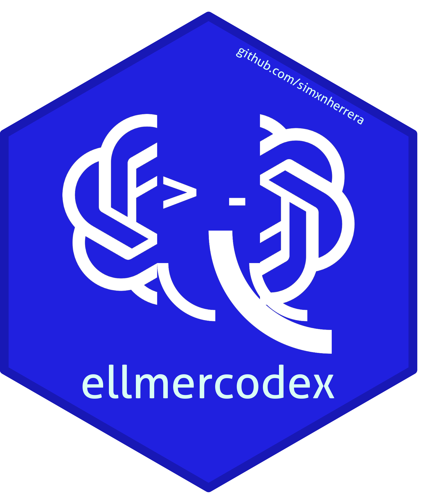

# ellmercodex 

<!-- badges: start -->

[](https://github.com/simxnherrera/ellmercodex/actions/workflows/R-CMD-check.yaml)
[](https://CRAN.R-project.org/package=ellmercodex)
[](https://CRAN.R-project.org/package=ellmercodex)
[](https://github.com/simxnherrera/ellmercodex/blob/main/LICENSE.md)

<!-- badges: end -->

> **Documentación en español:** empieza por
> [Primeros pasos](https://simxnherrera.github.io/ellmercodex/articles/ellmercodex-es.html).
> Todos los artículos están disponibles en español.

`ellmercodex` lets you use your ChatGPT plan from R as an
[`ellmer`](https://ellmer.tidyverse.org/) provider. You sign in once with your
ChatGPT account, and `chat_codex()` gives you an ordinary `ellmer` `Chat`:
no API key, and no Codex CLI. That makes it easy to bring language models
into your R analysis workflows.

It uses OpenAI's documented
["Sign in with ChatGPT"](https://developers.openai.com/siwc/token-sharing-open-source)
flow for open-source, locally hosted apps, and the public Responses API.
`ellmercodex` is an independent integration and is not affiliated with or
endorsed by OpenAI.

## Installation

Install the released version from CRAN:

```r
install.packages("ellmercodex")
```

Or the development version from GitHub with [`pak`](https://pak.r-lib.org/):

```r
install.packages("pak")
pak::pak("simxnherrera/ellmercodex")
```

If you are upgrading from 0.1.x, sign in again with `codex_login()`: the
authentication flow changed and earlier credentials are not kept.

## Usage

Sign in once; the credential is saved and refreshed for you:

```r
library(ellmercodex)

codex_login()
```

Then create a chat and talk to it:

```r
chat <- chat_codex(model = "gpt-6-luna", effort = "low")
chat$chat("Hello from R")
#> Hello! What are you working on in R?
```

Because `chat_codex()` returns an `ellmer` `Chat`, everything you know from
`ellmer` applies: streaming, async, images and PDFs, tool calling, and
structured data. For example, you can classify a speech from a parliamentary
debate and get back an R list instead of prose:

```r
chat$chat_structured(
  "Classify this excerpt as PREVENTIVE, PUNITIVE, or MIXED drug policy: ...",
  type = ellmer::type_object(
    stance = ellmer::type_enum(c("PREVENTIVE", "PUNITIVE", "MIXED")),
    rationale = ellmer::type_string()
  )
)
```

ChatGPT plan usage is an OpenAI preview: it needs an eligible plan and
workspace, works one conversation at a time, and does not accept arguments
such as `temperature` or `max_tokens`.

## Learn more

* [Get started](https://simxnherrera.github.io/ellmercodex/articles/ellmercodex.html):
  sign in, create a chat, and see what works from `ellmer`.
* [Signing in and credentials](https://simxnherrera.github.io/ellmercodex/articles/authentication.html):
  how sign-in works, where credentials are stored, and how to sign out.
* [Models and reasoning effort](https://simxnherrera.github.io/ellmercodex/articles/models.html):
  list your models, pick one, and set the reasoning effort.
* [Analyzing text](https://simxnherrera.github.io/ellmercodex/articles/text-analysis.html):
  structured data and tool calling on a real parliamentary debate.
* [Errors and limits](https://simxnherrera.github.io/ellmercodex/articles/errors-and-limits.html):
  what is not supported and how to handle errors.

The [technical design](https://github.com/simxnherrera/ellmercodex/blob/main/docs/technical-design.md)
and the [`ellmer` compatibility inventory](https://github.com/simxnherrera/ellmercodex/blob/main/docs/ellmer-chat-interface.md)
document the implementation in depth.
